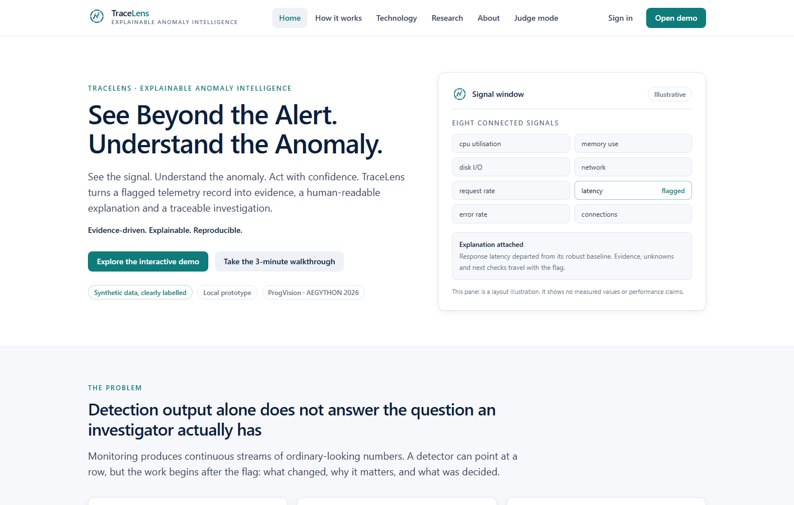
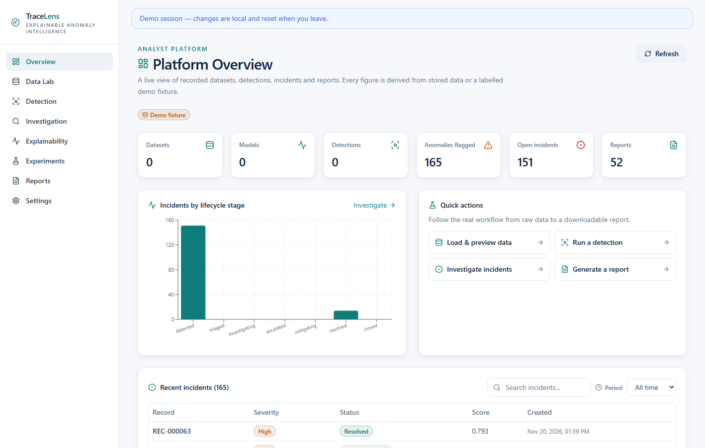
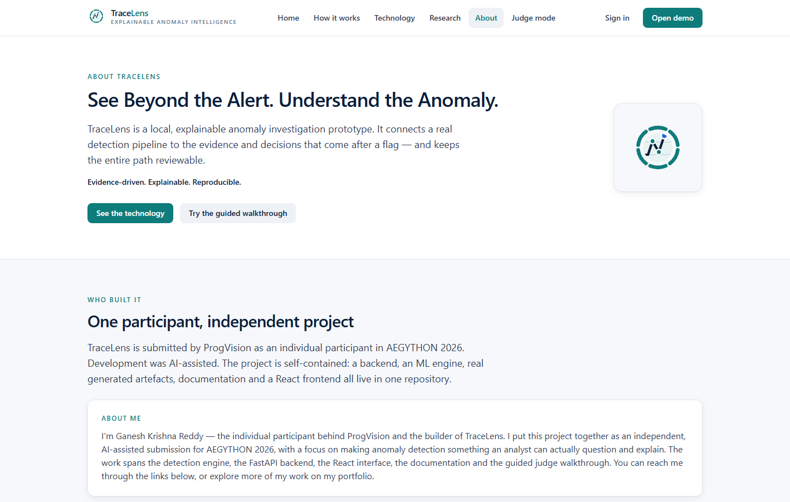
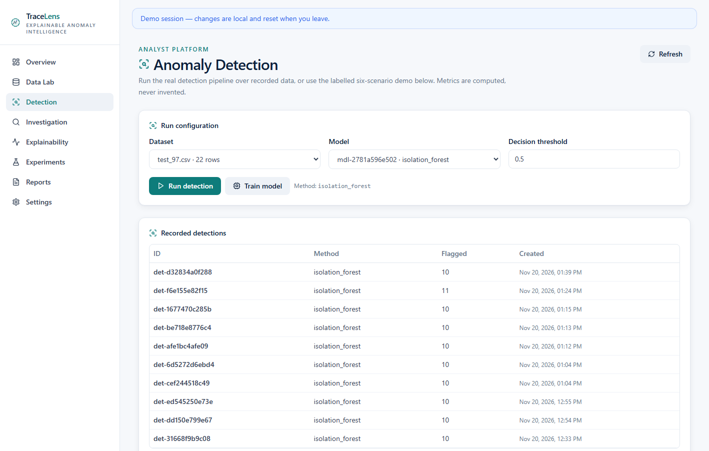
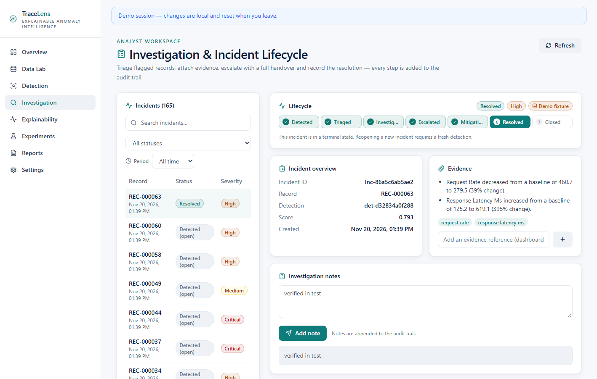
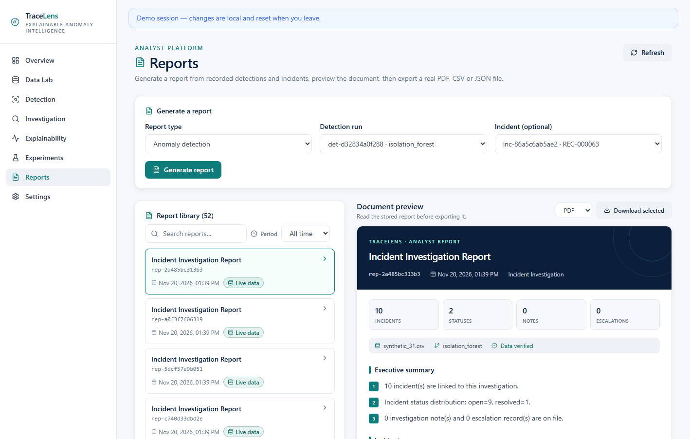
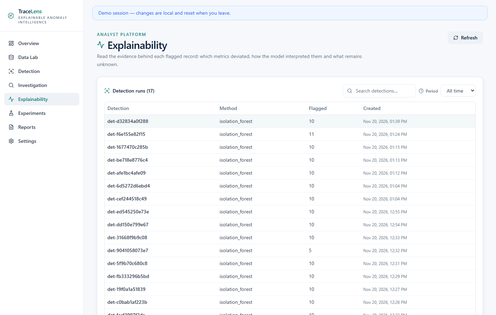
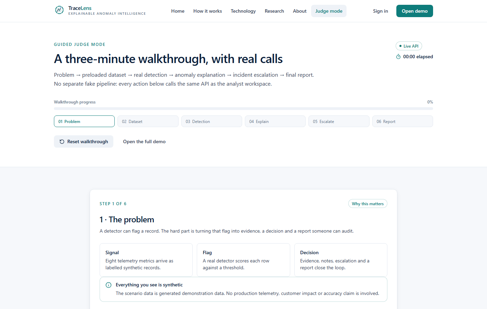
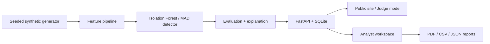

<div align="center">


**Explainable anomaly intelligence for people who have to act on the alert.**

*See the signal. Understand the anomaly. Act with confidence.*

[](https://www.python.org/)
[](https://react.dev/)
[](https://fastapi.tiangolo.com/)
[](documentation/TESTING_REPORT.md)
[](LICENSE)

**AEGYTHON 2026 · ProgVision · Individual participant · P. Ganesh Krishna Reddy**

</div>

---

## The problem

Anomaly detectors produce a flag. Investigators need a decision. Between those two
points, most tools lose the evidence: what was observed, which feature moved, what
the model actually interpreted, what to check next and what remains unknown.

TraceLens closes that gap. It runs a real detection pipeline over labelled synthetic
telemetry, evaluates it against ground truth, and carries every flag forward as an
investigable object with evidence, explanation, notes, escalation, resolution and a
report — all the way to a downloadable document.

No invented metrics. No fake customers. No dark-mode neon. Everything shown is
computed from the local database or a stored detection artefact, and all data is
labelled synthetic.

---

## Screenshots

Captured from the running local application — not mockups.

| Public site | Analyst workspace |
|---|---|
|  |  |
|  |  |

| Investigation & explainability | Reports & judge mode |
|---|---|
|  |  |
|  |  |

More captures: `frontend/public/screenshots/` (data lab, experiments, login, storytelling,
escalation). Manifest: `frontend/public/screenshots/CAPTURE_MANIFEST.json`.

[Watch the 1m46s demo video](demo/TraceLens_Demo.mp4)

---

## Features

### Public website
- **Story-led landing page** — problem, solution, method, architecture and proof, in that order.
- **About the project** — who built it, what is true, what is explicitly not claimed.
- **Technology and how-it-works** — detector comparison and an interactive architecture view.
- **Research and methodology** — generation setup, metrics and limitations.
- **Demo access, sign in and registration** — real local auth, no dead buttons.
- **Judge mode** — a guided walkthrough that calls the same API workflows as the analyst app.

### Analyst platform
- **Overview** — live counts and status derived from the store.
- **Data Lab** — inspect datasets, column statistics and previews; load synthetic scenarios.
- **Detection** — configure method and threshold, run against recorded data, review flags.
- **Investigation** — incidents with notes, escalation, resolution and an ordered activity trail.
- **Explainability** — per-feature deviations, evidence sentences, recommended next steps and unknowns.
- **Experiment Lab** — compare detectors/thresholds from stored results.
- **Reports** — generate, preview and export branded **PDF**, CSV or JSON documents.
- **Settings and session** — account state, demo controls and sign out.

### Engine and platform
- Seeded synthetic telemetry generator with eight numeric features and six demo scenarios:
  `normal`, `cpu_spike`, `memory_leak`, `network_surge`, `latency_error_surge`, `combined_anomaly`.
- Isolation Forest and robust statistical (MAD/IQR) detectors, leakage-safe split and measured
  accuracy, precision, recall, F1, FPR and ROC AUC.
- FastAPI service backed by SQLite, with additive idempotent migration (`scripts/migrate_v2.py`).
- Incident lifecycle: `detected → triaged → investigating → escalated → mitigating → resolved → closed`.
- Light-only design system: white/soft-grey surfaces, deep navy text, teal primary, blue secondary.

---

## Architecture



The frontend is React 19 + TypeScript + Vite + Tailwind 3. The backend is FastAPI with a
SQLite store and a standalone ML engine. Generated datasets, models, experiments, reports
and 28 documents live in the repository alongside the code.

---

## Run locally

Prerequisites: **Python 3.10+** (3.12 tested) and **Node.js 18+** with npm.

```bat
REM 1. Python dependencies
cd backend
python -m pip install -r requirements.txt
cd ..

REM 2. Frontend dependencies (once)
cd frontend
npm install
cd ..

REM 3. Start both services
START_TRACELENS.bat
```

| Service | URL |
|---|---|
| Website and analyst app | http://localhost:5173 |
| API | http://localhost:8000 |
| API docs | http://localhost:8000/docs |
| Health | http://localhost:8000/api/health |

Stop with `STOP_TRACELENS.bat`.

### Demo account

| Field | Value |
|---|---|
| Email | `demo@tracelens.local` |
| Password | `TraceLens2026!` |

You can also enter Judge Mode from the public site without an account; it uses the same
real API workflows with synthetic fixtures.

---

## Verification

```bat
python -m pytest backend/tests tests -q
cd frontend && npm run build
```

- **66 tests passed** (2 third-party deprecation warnings; no failures).
- Production frontend build succeeds. Vite reports a single advisory about one bundle
  chunk exceeding 500 kB — a size warning, not an error.
- Screenshots were captured from the running app with a headless browser; each is verified
  against expected rendered content.

---

## Repository layout

```
TraceLens/
├── backend/            FastAPI routes, schemas and SQLite services
├── ml-engine/          generator, features, detectors, evaluation, explanation
├── frontend/           React public site + analyst workspace
│   ├── public/brand/   logo pack and favicon
│   └── public/screenshots/  real application captures
├── documentation/      28 product, method, API, journey and QA documents
├── research/           anomaly-detection method notes
├── datasets/ models/ experiments/ reports/   generated artefacts
├── demo/               demo video and reproducible capture sources
├── scripts/            migration and screenshot tooling
├── tests/              backend and engine tests
└── START_TRACELENS.bat / STOP_TRACELENS.bat
```

Full API reference: `documentation/API_REFERENCE.md`. Journey coverage:
`documentation/USER_JOURNEYS.md`. Known limitations: `documentation/KNOWN_LIMITATIONS.md`.

---

## About me

I'm **Ganesh Krishna Reddy** — the individual participant behind ProgVision and the builder of TraceLens. I put this project together as an independent, AI-assisted submission for AEGYTHON 2026, focused on making anomaly detection something an analyst can question and explain. The work spans the detection engine, the FastAPI backend, the React interface, the documentation and the guided judge walkthrough.

- **GitHub:** [@ganeshkrishnareddy](https://github.com/ganeshkrishnareddy)
- **Source code:** [github.com/ganeshkrishnareddy/TraceLens](https://github.com/ganeshkrishnareddy/TraceLens)
- **LinkedIn:** [linkedin.com/in/pganeshkrishnareddy](https://linkedin.com/in/pganeshkrishnareddy)

---

## Scope and honesty

This is an independent, AI-assisted competition prototype running locally. It makes no
claim of employees, customers, partnerships, certification, production deployment or
accuracy on real-world telemetry. Detection thresholds are demonstration defaults, and
explanations describe feature deviations rather than causal root cause. Zero false
positives in the recorded experiment is a property of that synthetic split, not a
general result.

---

## Contact

- **Email:** pganeshkrishnareddy@gmail.com
- **LinkedIn:** https://linkedin.com/in/pganeshkrishnareddy
- **GitHub:** https://github.com/ganeshkrishnareddy
- **This repository:** https://github.com/ganeshkrishnareddy/TraceLens
- **Portfolio:** https://pganeshkrishnareddy.vercel.app/

Licensed under the [MIT License](LICENSE).
